# 웹 프로토타입 제작 기획 및 개발 보고서

- **과제명**: 맥도날드 주문 키오스크의 고령 사용자 경험 개선을 위한 웹 프로토타입 제작
- **교과목**: 휴먼컴퓨터인터페이스 (HCI)
- **작성자 / 학번**: 박진성 / 223610
- **작성일자**: 2026년 11월 1일
- **문서 버전**: v1.0

---

## 📌 [제출물 필수 요구 조건 요약]

| 제출 요구 조건 | 세부 내용 및 링크 |
|---|---|
| **1. 구현한 프로젝트 소스 코드 / GitHub 저장소 링크** | **GitHub Repository**: [https://github.com/lTvTl/uiux-improvement-prototype-mcdonald-korea-kiosks.git](https://github.com/lTvTl/uiux-improvement-prototype-mcdonald-korea-kiosks.git)<br>*(로컬 소스 코드: `done/index.html` 및 `done/uiux-improvement-prototype-mcdonald-korea-kiosks/index.html`)* |
| **2. 실행 가능한 결과물 / 배포된 웹사이트 링크** | **GitHub Pages 배포 링크**: [https://ltvtl.github.io/uiux-improvement-prototype-mcdonald-korea-kiosks/](https://ltvtl.github.io/uiux-improvement-prototype-mcdonald-korea-kiosks/)<br>*(로컬 실행: 브라우저에서 `index.html` 더블 클릭 즉시 실행 가능)* |
| **3. 프로젝트 설명 및 주요 기능 요약** | **목적**: 키오스크 주문/결제 자립도 향상 및 대기열 지연 해소 (유니버설 디자인 적용)<br>**핵심 개선**: ① 시작 광고 25% 축소 & 초대형 시작 버튼(E01/C01 해결) ② 함께 먹는 메뉴(사이드) 변경 버튼 200% 확대 & 치즈스틱 원클릭 변경(E02/C02 해결) ③ '계산대 직접 수령' 기본값 자동화로 불필요한 번호 입력 패닉을 생략하되, 자리 서빙을 원하는 고객을 위한 실제 '테이블 텐트 번호표(키오스크 옆 비치)' 키패드 입력 기능 온전 보존(E03/C03 해결) ④ 외래어의 알기 쉬운 한국어 전환 및 카드의 금색 앞면 투입 다감각 피드백 제공 |
| **4. 개발 과정에서 사용한 프롬프트 전체 내용** | 본 보고서 **[제5장 개발 과정에서 사용한 프롬프트 정리]**에 최초 생성, 기능 추가, UI/접근성 개선, 오류 수정/루프 단절 방지, 시연/배포 최적화 및 **사용자 피드백 반영(HCI 버튼 제거, 테이블 텐트 정상화, 한국어 순화)** 등 전 과정 프롬프트 수록 완료 *(※ 사용자 요청에 따라 GitHub에는 미업로드, 본 로컬 문서에서 보관/확인)* |

---

## 1. 지금까지 기획한 프로젝트의 목적, 주요 기능 및 사용자 요구사항

### 1-1. 프로젝트 배경 및 문제 정의 (5W1H)

| 질문 | 기획 내용 |
|---|---|
| **Who (누구의 문제인가?)** | 스마트폰이나 일반 무인민원기 경험은 일부 있으나, 복잡한 UI와 빠른 템포의 맥도날드 매장 키오스크 주문이 낯설고 어려운 **만 68세 전후의 고령층/노년층 고객** (대표 페르소나: 손주 간식을 사주러 방문한 68세 어르신) |
| **What (어떤 과업과 문제인가?)** | 1) 시작 화면의 화려하고 역동적인 전면 프로모션 영상으로 인한 '주문하기' 시작 버튼 탐색 지연<br>2) 메뉴 상세 화면에서 큰 버거 이미지에 가려 토핑/사이드 변경 버튼을 인지하지 못하고 기본 메뉴로 담았다가, 장바구니를 비우고 재주문하는 우회 오류 루프 발생<br>3) 결제 직전 예상치 못한 부가 서비스(테이블 서비스, 테이블 텐트/진동벨 번호 입력) 화면 직면 시 시스템 오류로 오인하여 '이전' 버튼을 연타하며 장바구니로 회귀하는 루프 단절 |
| **When (언제 발생하는가?)** | 뒤에 2명 이상의 대기자가 줄을 서 있어 빠른 주문에 대한 심리적 압박감이 극대화되는 피크 타임 및 일상 주문 상황 |
| **Where (어디서 발생하는가?)** | 소음과 안내 방송이 복합적으로 발생하는 오프라인 맥도날드 매장 내부 터치스크린 키오스크 앞 |
| **Why (왜 중요한가?)** | 주문 반복, 조작 실패, 직원 호출 및 중도 포기를 유발하여 고령 고객의 디지털 소외감을 심화시키고, 매장 대기열 병목과 운영 비효율을 초래하기 때문 |
| **How (현재 어떻게 대처하는가?)** | 원치 않는 기본 구성(감자튀김/콜라) 그대로 주문하거나, 당황하여 '이전' 버튼을 연타하다가 키오스크 이용을 포기하고 대면 카운터로 이동함 |

#### 관찰 기반 핵심 문제 근거 (E01 ~ E03 / C01 ~ C03)
- **근거 1 (E01 / C01)**: 시작 화면에서 상단의 대형 프로모션 영상에 시선이 8초 이상 정체되며 "TV 광고 화면인 줄 알았다"고 발화함. 시작 버튼의 기표(Signifier)와 가시성(Visibility)이 심각하게 부족함.
- **근거 2 (E02 / C02)**: 버거 사진에 비해 사이드 변경 버튼이 작고 텍스트 형태로 숨겨져 있어 버튼임을 인지하지 못함. 감자튀김이 담긴 장바구니를 비우고 처음부터 다시 시도하느라 2분 이상의 불필요한 체류 시간 낭비 발생.
- **근거 3 (E03 / C03)**: 결제하기를 눌렀으나 신용카드 삽입 대신 생소한 '진동벨 번호 입력' 화면이 나타나자, 자신이 조작을 잘못한 것으로 오인하고 화면 상단의 '← 이전' 버튼을 2회 연속 클릭하여 결제 루프가 단절됨.

---

### 1-2. 프로젝트 목표 및 정량적 성공 지표 (SMART)

> **최종 목표**: 
> 키오스크 사용 경험이 있는 고령 사용자가 맥도날드 키오스크에서 **버거 세트 메뉴 선택 → 사이드/음료 변경 → 신용카드 결제**를 수행할 때, **결제 완료 소요 시간을 58초에서 30초 이하로 단축**하고, **결제 과정 재시도(이전 회귀) 횟수를 0.8회에서 0.2회 이하로 개선**한다.

| 핵심 지표 | 정의 및 측정 방법 | 현재값 (As-is) | 목표값 (To-be) | 성격 |
|---|---|:---:|:---:|:---:|
| **세부 옵션(사이드) 변경 성공률** | 첫 탐색 시 오클릭 없이 의도한 사이드 변경 버튼을 누른 비율 | 55% | **90% 이상** | 가상 기준 |
| **결제 완료 소요 시간** | '결제하기' 버튼 터치부터 신용카드 승인 및 영수증 출력까지 소요 시간(초) | 58초 | **30초 이하** | 가상 기준 |
| **결제 루프 단절(재시도) 횟수** | 결제 진행 중 당황하여 '이전' 버튼을 누르고 장바구니로 되돌아간 횟수 | 평균 0.8회 | **평균 0.2회 이하** | 가상 기준 |
| **직원 도움 요청률** | 과업을 스스로 완수하지 못하고 직원에게 도움을 청하거나 포기한 비율 | 50% | **20% 이하** | 가상 기준 |

---

### 1-3. 작업 흐름 비교 (As-is vs To-be)

```mermaid
flowchart TD
    subgraph AsIs ["기존 As-is 흐름 (루프 단절 및 오류 복구 발생)"]
        A1["시작 동적 광고 (8초 체류)"] --> A2["하단 작은 '주문하기' 터치"]
        A2 --> A3["빅맥 세트 선택"]
        A3 --> A4["작은 변경 버튼 미인지 → 기본 장바구니 담기"]
        A4 --> A5["장바구니 삭제(X) 후 재선택 (2분 지연 우회 루프)"]
        A5 --> A6["작은 사이드 변경 버튼 겨우 클릭"]
        A6 --> A7["결제하기 터치"]
        A7 --> A8["추천 메뉴 추가 팝업 (선택 안 함 클릭)"]
        A8 --> A9["테이블 서비스 번호 입력 강제 (당혹감!)"]
        A9 --> A10["'← 이전' 연타 장바구니 회귀 (루프 단절)"]
        A10 --> A11["카운터 수령 수동 탐색 후 카드 결제"]
    end

    subgraph ToBe ["개선 To-be 흐름 (직관적 단일 핵심 경로)"]
        B1["광고 축소 + 중앙 초대형 '주문하기' (원터치)"] --> B2["매장식사 / 포장주문 명확한 2분할 선택"]
        B2 --> B3["버거 세트 선택 즉시 200% 확대된 '사이드 변경' 강조"]
        B3 --> B4["원클릭 치즈스틱 변경 및 장바구니 담기"]
        B4 --> B5["불필요한 추천 팝업 전면 생략"]
        B5 --> B6["'카운터 직접 수령' 기본값 자동 직행 안내 (2초)"]
        B6 --> B7["IC칩 방향 시각 모션 + 음성 안내로 카드 1회 결제 완료"]
    end
```



---

### 1-4. 사용자 핵심 요구사항 (우선순위별 정리)

1. **[우선순위 1] 사이드/토핑 변경 버튼 시인성 및 면적 200% 확대**
   - 상품 이미지에 집중된 시선을 분산시키지 않도록 변경 버튼 면적을 2배 이상 키우고, 고대비 테두리(`border-primary`)와 "변경 가능" 뱃지, 부드러운 유도 애니메이션을 적용하여 세트 선택 즉시 조작 가능 요소임을 인지하게 한다.
2. **[우선순위 2] 부가 서비스 기본값 자동화(카운터 직접 수령) 및 결제 직행**
   - 결제 직전 불필요한 추천 메뉴 모달을 제거하고, 고령자에게 패닉을 유발하는 테이블 번호/진동벨 입력을 기본 경로에서 제외한다. '카운터 직접 수령'을 기본값으로 자동 설정하여 결제하기 터치 즉시 카드 삽입 화면으로 직행시킨다.
3. **[우선순위 3] 시작 화면 광고 영역 축소 및 대형 '주문하기' 버튼 배치**
   - 전면 동영상 광고 면적을 상단 25~30%로 축소하고, 화면 중앙에 고대비의 초대형 '주문하기' 버튼을 배치하여 시스템이 조작 가능한 상태임을 명확히 전달한다.
4. **[우선순위 4] 이동약자를 위한 보조 옵션 유지 (반대 사례 반영)**
   - 거동이 불편한 고령자 및 휠체어 이용자를 고려하여, 테이블 서비스 기능을 완전히 삭제하지 않고 결제 전 화면 하단에 '자리로 가져다주기(테이블 서빙)' 보조 버튼으로 분리 제공한다.
5. **[우선순위 5] 다감각 결제 피드백 제공 (IC칩 방향 그래픽 + 안내 문구)**
   - 카드 투입구의 마그네틱/IC칩 혼동을 방지하기 위해 카드의 금색 칩 방향을 직관적으로 보여주는 모션 그래픽과 명확한 텍스트/음성 피드백을 제공한다.

---

## 2. 기획 내용을 실제 웹사이트/서비스로 구현 (구현 설계 명세)

### 2-1. 프로토타입 구현 범위 및 기술 스택

- **구현 과업 범위 (Critical Path)**:
  `시작 화면 → 식사 장소 선택(매장/포장) → 버거 세트(빅맥 세트) 선택 → 사이드 변경(감자튀김→치즈스틱) → 장바구니 확인 → 카운터 기본값 직행 → 모의 카드 결제 애니메이션 → 영수증/번호표 발급 완료`
- **구현 방식 및 권장 기술**:
  - 현대적 반응형 웹 표준 기술: **HTML5, Tailwind CSS, 모던 JavaScript (ES6+)** 또는 **React / Next.js (shadcn/ui)**
  - 키오스크 세로형 화면 비율(9:16 비율, 1080x1920 기준 모바일/태블릿 레이아웃) 최적화
  - 접근성(WCAG 2.1 AA) 준수: 본문 글꼴 최소 18px 이상, 버튼 높이 최소 64px 이상, 명도 대비 4.5:1 이상 유지

---

### 2-2. 화면별 세부 UI 컴포넌트 명세

#### 화면 1: 시작 화면 (Start Screen)
- **상단 배너 (25% 높이)**: 맥도날드 대표 프로모션 정적/루프 배너 (시각적 자극 완화)
- **화면 중앙**: 고대비(맥도날드 Red & Golden Yellow)의 초대형 **'주문 시작하기 (터치하세요)'** 버튼 (미세한 Pulse 펄스 애니메이션)
- **하단 안내**: "화면을 터치하시면 주문이 시작됩니다" (고대비 22px 볼드 텍스트)

#### 화면 2: 식사 장소 선택 화면 (Dine-in / Take-out)
- **좌우 2분할 대형 카드 버튼**:
  - `[ 매장에서 식사 ]` (매장 일러스트 아이콘 + 직관적 큰 텍스트)
  - `[ 포장해 가기 ]` (쇼핑백 일러스트 아이콘 + 직관적 큰 텍스트)

#### 화면 3: 메뉴 탐색 및 선택 화면 (Menu Selection)
- **상단 카테고리 탭**: `추천메뉴 | 버거세트 | 단품 | 음료/디저트` (가로 스크롤 최소화, 큰 탭 버튼)
- **메뉴 카드 리스트**: 빅맥 세트, 1955 버거 세트, 불고기 버거 세트 등
  - 고령자의 가독성을 위해 상품명(24px 볼드), 가격(22px), 세트 구성 안내를 카드 내에 명확히 표기

#### 화면 4: 메뉴 상세 및 사이드 변경 모달 (핵심 개선 지점: Req 1)
- **빅맥 세트 기본 정보 카드**: 버거 사진, 기본 구성(빅맥 + 후렌치 후라이 M + 코카콜라 M)
- **사이드 구성품 박스**:
  - 기존: 작은 텍스트 링크 형태
  - **개선**: 면적 200% 확대 버튼, 골드색 테두리(`border-2 border-amber-500`), **'🍟 사이드 변경 (+0원부터)'** 강조 버튼 및 반짝임 효과
- **사이드 변경 팝업 모달**:
  - `[ 후렌치 후라이 (기본) +0원 ]`
  - `[ 치즈스틱 2조각 (+500원) - 선택 ]`
  - `[ 코울슬로 (+0원) ]`
- **하단 확인 버튼**: **'선택 완료 및 장바구니 담기'** (초대형 녹색 버튼, 70px 높이)

#### 화면 5: 장바구니 및 수령 방식 선택 (핵심 개선 지점: Req 2)
- **장바구니 리스트**: 선택된 구성(빅맥 세트 / 함께 먹는 메뉴: 치즈스틱 2조각) 명확한 텍스트 강조
- **불필요한 추천 메뉴 추가 팝업 전면 제거**
- **수령 방식 선택 인터랙션 (테이블 텐트 기능 정상화)**:
  - **선택지 1 (기본값 자동 체크)**: `[ 계산대에서 직접 받기 ] (추천 · 가장 빠름)` -> 결제 시 복잡한 번호 입력 없이 즉시 카드 투입으로 직행!
  - **선택지 2 (자리 서빙)**: `[ 자리로 직원 배달 받기 (테이블 텐트 번호표 사용) ]` -> 키오스크 왼쪽 거치대의 삼각 텐트 번호표를 집어 들고 적힌 숫자를 화면의 숫자 키패드로 직접 입력(예: 15번)하여 자리에 들고 착석하는 실제 맥도날드 테이블 텐트 프로세스 완벽 지원
- **하단 주문 버튼**: **'신용카드 결제하기 (총 7,400원)'** (가로 전체 채움, 고대비 레드)

#### 화면 6: 신용카드 결제 및 다감각 피드백 (Payment Screen)
- **쉬운 한국어 전환**: 'IC칩', '마그네틱' 등 어려운 외래어를 배제하고 **"카드의 [노란색 금색 네모 부분(앞면)]이 앞/위쪽을 향하도록 투입구에 끝까지 넣어주세요"**로 명확히 안내
- **중앙 모션 그래픽**: 신용카드의 금색 네모 부분이 앞을 향해 투입구로 들어가는 시각 애니메이션
- **모의 인터랙션**: `[정방향: 금색 앞면 투입]`(정상 승인) vs `[역방향: 반대로 투입]`(경고 비프음 및 재삽입 안내) 지원

#### 화면 7: 주문 완료 및 영수증 (Order Complete)
- **주문 번호 대형 표기**: `주문번호 234번` (초대형 60px 볼드)
- **수령 방식별 동적 맞춤 안내**:
  - 계산대 수령 시: "1번 계산대 전광판에 234번이 표시되면 음식을 찾아가세요."
  - 테이블 텐트 선택 시: "테이블 번호표 15번을 들고 자리에 앉아 계시면 직원이 음식을 직접 가져다 드립니다."
- **15초 자동 초기화 카운트다운** 및 즉시 처음으로 버튼

---

## 3. 구현 결과 실행, 오류 수정 및 개선 계획

### 3-1. 실행 환경 및 브라우저 호환성
1. **실행 환경**:
   - 모던 웹 브라우저 (Chrome, Edge, Safari 등)에서 별도 설치 없이 즉시 실행
   - 데스크톱 화면에서도 키오스크 비율(가로 450~540px, 세로 850~960px의 중앙 모바일 프레임)로 자동 렌더링되도록 뷰포트 컨테이너 설계
2. **반응형 대응**:
   - 터치 디바이스(태블릿/스마트폰) 접속 시 전체 화면(Full Viewport)으로 터치 조작 지원

---

### 3-2. 고령자 사용성(HCI) 개선 및 오류 수정 점검표

| 점검 영역 | 평가 항목 | 검증 기준 | 미충족 시 수정 방안 |
|---|---|---|---|
| **가시성 (Visibility)** | 시작 화면 버튼 크기 | 화면 중앙 50% 이상 영역 차지, 대비 4.5:1 이상 | 버튼 패딩 확대 및 배경색 대비 강화 (`bg-amber-400 text-neutral-900`) |
| **기표 (Signifier)** | 사이드 변경 버튼 인식 | 단순 텍스트가 아닌 '눌리는 버튼' 입체감/테두리 확인 | 외곽선 3px, 호버/터치 애니메이션(`scale-105`), '변경' 뱃지 부착 |
| **대응 관계 (Mapping)** | 결제 진입과 수령 방식 | 결제 클릭 후 진동벨 입력 없이 즉시 카드 화면 전환 | 테이블 서비스 단계를 기본값 처리하고 2초 안내 토스트로 대체 |
| **피드백 (Feedback)** | 옵션 선택 및 결제 상태 | 사이드 변경 시 장바구니에 변경 내역 명시 | 치즈스틱 변경 시 노란색 하이라이트 태그(`[사이드: 치즈스틱]`) 부착 |
| **제한 사항 (Constraints)**| 오조작 및 이탈 방지 | 뒤로가기 시 주문 전체 취소 방지 | 모달 닫기 버튼을 크고 명확한 '취소 및 이전' 버튼으로 통일 |

---

## 4. 완성된 프로젝트 웹 배포 및 공유 계획

### 4-1. 배포 플랫폼 선정 및 설정
- **GitHub Pages 연동 완료**:
  - 리포지토리: [https://github.com/lTvTl/uiux-improvement-prototype-mcdonald-korea-kiosks.git](https://github.com/lTvTl/uiux-improvement-prototype-mcdonald-korea-kiosks.git)
  - 배포 URL: [https://ltvtl.github.io/uiux-improvement-prototype-mcdonald-korea-kiosks/](https://ltvtl.github.io/uiux-improvement-prototype-mcdonald-korea-kiosks/)
  - 설정 방법: GitHub 리포지토리 `Settings` → `Pages` 이동 → `Build and deployment` 섹션에서 Source를 `Deploy from a branch`로 선택하고, Branch를 `main` / `/ (root)`로 지정한 뒤 `Save` 클릭 시 자동 배포 완료됩니다.

### 4-2. 공유 및 사용성 평가(UT) 진행 방안
1. **실행 링크 및 QR 코드 생성**:
   - 배포 완료된 라이브 URL(`https://ltvtl.github.io/uiux-improvement-prototype-mcdonald-korea-kiosks/`)을 QR 코드로 변환하여 보고서 및 발표 자료에 첨부
   - 스마트폰이나 태블릿에서 QR 코드를 스캔하여 실제 매장 키오스크처럼 터치 테스트 수행 가능
2. **과제 제출 및 시연 링크 공유**:
   - GitHub 저장소 링크 및 GitHub Pages 라이브 데모 링크를 함께 제출
   - 평가자(교수님 및 동료)가 별도 설치 없이 브라우저 클릭 한 번으로 As-is 대비 To-be 프로토타입의 흐름(우측 상단 'HCI 개선점' 팝업 및 실시간 소요시간 측정 포함)을 직접 체험하도록 구성

---

## 5. 개발 과정에서 사용한 프롬프트 정리

프로토타입 제작 시 AI 코드 어시스턴트(Claude, ChatGPT, v0, Bolt, Lovable, Cursor 등)에 입력하여 고품질의 HCI 개선 키오스크를 구현할 수 있도록 단계별 프롬프트를 체계적으로 정리합니다.

### 5-1. 최초 생성 프롬프트 (Initial Prompt)

```text
[역할 정의]
당신은 고령자 접근성(A11y)과 HCI 인터랙션 디자인에 특화된 시니어 프론트엔드 엔지니어입니다.

[프로젝트 목적]
맥도날드 매장 키오스크를 처음 접하는 68세 고령 고객이 겪는 3대 장벽(시작 광고로 인한 시작 버튼 미인지, 토핑/사이드 변경 버튼 미인지, 결제 직전 테이블 번호 입력으로 인한 패닉 및 이전 회귀)을 해결하는 고충실도 인터랙티브 웹 프로토타입을 단일 HTML 파일(Tailwind CSS + Lucide Icons + 모던 Vanilla JS 포함)로 제작해 주세요.

[디스플레이 규격]
- 키오스크 세로 비율(모바일/태블릿 화면 크기, max-w-md, mx-auto) 중앙 배치 프레임
- 폰트 크기 기본 18px 이상, 버튼 높이 최소 60px 이상, 고대비 색상(맥도날드 레드 #DA291C, 골드 #FFC72C, 다크 차콜 #27251F)

[핵심 구현 시나리오 (Critical Path)]
1. 시작 화면: 상단 25% 프로모션 배너 + 중앙 초대형 맥도날드 골드 '주문 시작하기 (터치하세요)' 버튼 (부드러운 펄스 애니메이션)
2. 식사 장소 선택: '매장에서 식사' vs '포장해 가기' 큼직한 2분할 버튼
3. 메뉴 선택: 버거 탭에서 '빅맥 세트 (6,900원)' 선택
4. 사이드 변경 모달 (가장 중요):
   - 빅맥 세트 상세 화면에서 '사이드 변경' 버튼이 상품 사진 아래에서 눈에 확 띄도록 200% 확대, 3px 골드 테두리, '변경 가능' 뱃지 적용
   - 클릭 시 사이드 선택 팝업 오픈: '후렌치 후라이(기본)' / '골든 모짜렐라 치즈스틱 (+500원)'
   - 치즈스틱 선택 후 '장바구니 담기'
5. 장바구니 및 즉시 결제 진입:
   - 추천 팝업 전면 생략
   - '카운터 직접 수령(기본값)' 안내 배너 표시 (테이블 번호 입력 단계 완전 제거)
   - 하단 대형 '신용카드 결제하기' 버튼
6. 카드 결제 피드백 화면:
   - 카드의 금색 IC칩이 앞을 향해 투입구로 들어가는 시각적 모션 일러스트
   - "카드를 끝까지 밀어 넣어주세요" 음성 텍스트 피드백
   - '모의 카드 투입' 버튼 클릭 시 1.5초 로딩 후 승인 완료
7. 완료 화면: 큰 주문번호(234번) 표기 및 카운터 픽업 안내

위 요구사항을 완전히 동작하는 하나의 완성도 높은 코드로 작성해 주세요.
```

---

### 5-2. 기능 추가 및 세부 인터랙션 프롬프트 (Feature Enhancement)

```text
[사이드 변경 및 장바구니 인터랙션 강화]
메뉴 상세 모달에서 고령 사용자가 '사이드 변경' 버튼을 누르면 다음 인터랙션이 발생하도록 코드를 보완해 줘:
1. '사이드 변경' 버튼을 누르면 부드러운 페이드인과 함께 사이드 선택 서브모달이 뜨게 해줘.
2. '골든 모짜렐라 치즈스틱(+500원)'을 선택하면 즉시 체크 표시(✓)와 함께 총 주문금액이 6,900원에서 7,400원으로 실시간 업데이트되게 해줘.
3. '장바구니 담기'를 누르면 상단 또는 하단 장바구니 영역으로 메뉴가 쏙 들어가는 시각적 바운스 애니메이션을 주고, 장바구니 내역에 '[사이드: 치즈스틱 변경]' 텍스트를 노란색 볼드체 태그로 명확히 표시해 줘.
```

---

### 5-3. 디자인 및 고령자 접근성 개선 프롬프트 (Accessibility & UI Improvement)

```text
[고령자 접근성(KWCAG / WCAG 2.1 AA) 디자인 개선]
현재 프로토타입의 디자인을 65세 이상 고령층의 시력 및 인지적 특성에 맞춰 다음과 같이 개선해 줘:
1. 색상 대비: 모든 버튼의 배경색과 글자색 대비를 4.5:1 이상으로 유지해 줘. 옅은 회색 텍스트(#9CA3AF)는 모두 진한 차콜(#1F2937)로 변경해 줘.
2. 터치 영역: 모든 주요 액션 버튼의 높이를 최소 64px(h-16) 이상으로 확장하고, 클릭 시 명확한 눌림 효과(active:scale-95)를 적용해 줘.
3. 텍스트 가독성: 돋보기를 착용한 상태에서도 편안히 읽을 수 있도록 모든 상품명은 22px 이상, 가격은 20px 이상, 세부 옵션 안내는 18px 이상으로 확대해 줘.
4. 상태 안내 배너: 결제 화면으로 넘어갈 때 "복잡한 번호 입력 없이 카운터에서 바로 준비해 드립니다"라는 안심 문구를 상단에 초록색 배너로 강조해 줘.
```

---

### 5-4. 오류 수정 및 루프 단절 방지 프롬프트 (Bug Fixes & Loop Restoration)

```text
[결제 루프 단절 방지 및 오류 복구 개선]
고령 사용자가 결제 도중 당황하여 '이전' 버튼을 누르거나 주문을 취소하는 문제를 방지하기 위해 다음을 수정해 줘:
1. 결제 대기 화면에서 '이전' 버튼을 누를 경우, 주문이 취소되는 대신 "주문 내역이 장바구니에 안전하게 보관되어 있습니다. 장바구니로 돌아가시겠습니까?"라는 명확한 확인 모달을 띄워줘.
2. 모의 카드 결제 인터랙션에서 사용자가 카드를 거꾸로 넣는 실수를 시뮬레이션할 수 있도록 [카드를 반대로 넣음] 버튼과 [정방향 투입] 버튼을 제공하고, 반대로 넣었을 때는 "카드의 금색 IC칩이 앞을 향하도록 돌려 꽂아주세요"라는 노란색 경고 피드백과 소리 효과(Web Audio API 비프음)를 출력하도록 개선해 줘.
```

---

### 5-5. 공유 및 발표용 최종 다듬기 프롬프트 (Polishing for Deployment)

```text
[배포 및 과제 시연 최적화]
이 웹 키오스크 프로토타입을 다른 학생들이나 교수님이 브라우저에서 바로 테스트해 볼 수 있도록 최적화해 줘:
1. 타이머를 통해 주문 진행 소요 시간을 실시간으로 측정하여 결제 완료 시 목표 시간(30초 이하) 달성 여부를 직관적으로 보여줘.
2. GitHub Pages 및 Vercel에서 즉시 단일 파일로 동작할 수 있도록 외부 의존성(CDN 스크립트)을 안정적인 버전으로 번들링해 줘.
```

---

### 5-6. 사용자 피드백 반영 및 유니버설 디자인 순화 프롬프트 (Feedback Refinement)

```text
[사용자 피드백 3대 개선 사항 반영]
1. 불필요한 연구자용 요소 제거:
   - 화면 우측 상단의 'HCI 개선점' 버튼 및 팝업 모달을 완전히 제거하고, 소리 켜기/끄기 토글 버튼만 깔끔하게 유지해 줘.

2. 테이블 텐트(Table Tent) 기능 정상화 및 보존:
   - 기존 기능을 임의로 축소하거나 alert 창으로 뭉개지 말고 실제 맥도날드 테이블 텐트 서비스를 완전히 구현해 줘.
   - 키오스크 왼쪽에 비치된 실제 삼각 텐트 모양의 번호표를 집어 들고 번호를 입력하는 프로세스를 살려줘.
   - 장바구니 화면에서 수령 방식을 명확한 라디오 카드 형태로 제공하되, '계산대에서 직접 받기'를 기본값으로 자동 체크하여 일반 고객은 번호 입력 없이 즉시 결제로 직행하게 해줘.
   - 고객이 '자리로 직원 배달 받기 (테이블 번호표 사용)'를 누르면, 키패드가 달린 모달이 떠서 텐트 번호표의 번호(예: 15)를 직접 입력할 수 있게 해줘.
   - 결제 완료 화면에서도 선택한 수령 방식에 맞춰 '계산대 수령 안내' 또는 '테이블 번호표(15번) 서빙 안내'로 각각 정확하게 분기 출력되도록 해줘.

3. 유니버설 디자인 및 한국어 순화:
   - 화면 전반에서 '고령', '어르신', '노년' 등의 단어를 모두 제거하여 특정 집단만을 위한 키오스크로 느껴지지 않게 해줘.
   - 외래어나 이해하기 어려운 전문 용어를 알기 쉬운 한국어로 전환해 줘:
     * '사이드 메뉴' -> '함께 먹는 메뉴 (감자튀김/치즈스틱)'
     * '테이크아웃' -> '포장해 가기'
     * 'IC칩' -> '카드의 금색 네모 부분 (앞면)'
     * '카운터' -> '계산대 (음식 받는 곳)'
     * '테이블 텐트' -> '테이블 번호표 (자리 서빙용)'
```

---

### 5-7. 화면 내 모든 미구현/더미 버튼의 완전한 기능 활성화 프롬프트 (Full Interactive Implementation)

```text
[화면 내 모든 미구현 버튼 인터랙션 활성화 요청]
프로토타입 화면에 보이는 모든 버튼 중 현재 동작하지 않거나 더미로 남아있는 요소들을 완전히 작동하도록 구현해 줘:

1. 카테고리 탭(세트 메뉴, 단품, 함께 먹는 메뉴, 음료) 전환 기능:
   - 각 탭을 누르면 탭 활성화 스타일이 변경되고, 해당 카테고리의 실제 메뉴 목록(빅맥, 1955, 불고기, 상하이 버거 및 단품, 감자튀김/치즈스틱/너겟, 콜라/제로콜라/스프라이트/커피 등)이 동적으로 렌더링되게 해줘.
   - 각 메뉴 카드를 누르면 세트 메뉴는 세부 옵션(사이드+음료) 모달이 뜨고, 단품/음료류는 수량 선택 후 장바구니에 바로 담을 수 있게 해줘.

2. 세부 옵션 모달 내 음료 변경 기능 추가:
   - 세트 메뉴 선택 시 '함께 먹는 메뉴(사이드)'뿐 아니라 '음료'도 [다른 음료로 바꾸기] 버튼을 제공해 줘.
   - 클릭 시 음료 선택 팝업(코카콜라, 코카콜라 제로, 스프라이트, 드립 커피 등)이 뜨고 선택한 음료가 실시간 반영되게 해줘.

3. 장바구니 품목 관리 기능 고도화:
   - 장바구니 화면에서 각 품목의 수량을 늘리고 줄일 수 있는 [+] / [-] 버튼과 [삭제] 버튼을 구현해 줘.
   - 상단에 [메뉴 더 담기] 버튼을 두어 여러 메뉴를 추가할 수 있게 하고, 하단 고정 바의 [장바구니 0개 (보기)] 영역을 누르면 언제든 장바구니 화면으로 즉시 이동하게 해줘.

4. 직원 호출 전용 모달 컴포넌트:
   - 브라우저 기본 alert 대신 키오스크 전용의 친절한 '직원 호출 완료 안내 모달'을 띄워줘.
```

---

### 5-8. 햄버거 토핑(속재료 추가/빼기) 맞춤 선택 기능 구현 프롬프트 (Topping Customization)

```text
[햄버거 토핑/속재료 맞춤 변경 기능 추가]
버거 세트 및 버거 단품 메뉴를 선택했을 때 햄버거의 속재료(토핑)를 고객이 직접 변경할 수 있도록 기능을 추가해 줘:

1. 세부 옵션 모달 내 '버거 토핑 변경' 블록 배치:
   - 버거 품목일 때 상단에 [버거 속재료(토핑) 변경] 블록을 배치하고, 현재 선택된 상태('기본 구성' 또는 '+치즈 1장, 피클 제외')와 [버거 속재료 변경하기] 버튼을 제공해 줘.

2. 전용 토핑 선택 모달 컴포넌트:
   - 버튼 클릭 시 '버거 속재료 맞춤 선택' 모달을 띄워줘.
   - [재료 추가하기 (더 맛있게)]:
     * 🧀 체다 치즈 1장 추가 (+300원)
     * 🍅 신선한 토마토 1장 추가 (+400원)
     * 🥓 바삭한 베이컨 2장 추가 (+600원)
     * 🥩 순 쇠고기 패티 1장 추가 (+1,500원)
   - [재료 빼기 (안 드시는 재료 제외)]:
     * 🥒 피클 빼기 (무료)
     * 🧅 생양파 빼기 (무료)
     * 🥫 특제 소스 빼기 (무료)
   - 체크박스로 다중 선택이 가능하게 하고, 하단에 [토핑 변경 완료 (+금액)] 버튼과 [기본 구성으로 초기화] 버튼을 제공해 줘.

3. 장바구니 및 결제 연동:
   - 변경된 토핑 내역이 모달과 장바구니 카드에 '🥬 토핑: 치즈 추가(+300원), 피클 제외' 형태로 명확히 표기되고, 추가된 금액이 총 주문금액에 정확히 합산되게 해줘.
```

---

### 5-9. '메뉴 더 담기' 버튼 위치 개선 및 크기 확대 프롬프트 (Button Repositioning & Sizing)

```text
[메뉴 더 담기 버튼 위치 및 시인성 개선]
마지막 결제 직전 장바구니 화면에서 '메뉴 더 담기' 버튼이 너무 작고 상단 구석에 있어 인지하기 어렵습니다. 다음과 같이 개선해 줘:

1. 버튼 위치 변경:
   - 상단 헤더 우측의 작은 버튼을 제거하고, 최종 결제 금액 확인 영역과 [신용카드 결제하기] 버튼 바로 위로 이동시켜 줘.

2. 시각적 크기 및 시인성 확대:
   - 가로 전체 폭(w-full)을 차지하는 대형 버튼(h-15, 60px 상당)으로 확대하고, 부드러운 노란색/호박색 배경(bg-amber-100)과 테두리(border-2 border-amber-400), 큰 아이콘(fas fa-plus-circle)을 적용해 줘.
   - 버튼 텍스트를 "다른 메뉴 더 담기 (추가 주문하기)"로 명확히 표기하여 결제 전 다른 메뉴를 더 시키고 싶은 고객이 고민 없이 누를 수 있게 해줘.
```

---

### 5-10. 시작 화면 프로모션 광고 클릭 시 해당 메뉴 옵션 모달 직행 프롬프트 (Direct Promo Item Selection)

```text
[시작 화면 광고 클릭 인터랙션 개선]
시작 화면 상단의 프로모션 광고 배너를 클릭했을 때, 식사 장소 선택 등 불필요한 중간 단계로 넘어가지 않고 해당 광고 상품의 메뉴 선택 모달로 즉시 직행하도록 개선해 줘:

1. 광고 배너 인터랙션 분기:
   - 시작 화면의 [주문 시작하기] 중앙 대형 버튼을 누르면 정상적인 1단계인 '식사 장소 선택(매장/포장)'으로 진행하게 해줘.
   - 반면 상단의 프로모션 배너('갓 구운 빅맥®')를 누르면, 기본 식사 장소를 '매장에서 식사'로 자동 세팅한 뒤, 메뉴 화면으로 즉시 이동하여 광고에 나온 메뉴인 '빅맥® 세트'의 세부 구성/옵션(토핑/사이드/음료) 선택 모달을 화면에 바로 띄워줘.

2. 시각적 기표 강화:
   - 배너에 '👆 터치 시 바로 주문' 뱃지와 '광고를 누르면 빅맥® 세트 선택 창으로 바로 이동합니다' 안내 문구를 추가하여 고객이 누르면 바로 해당 버거를 주문할 수 있음을 직관적으로 알 수 있게 해줘.
```

---

## 6. 결론 및 향후 계획

본 문서는 지금까지 진행된 인터랙션 분석, UI 디자인 방법론, 사용자 연구 계획, 맥락질의 인터뷰, 작업분석 및 어피니티 다이어그램의 연구 결과를 총망라하여, 실제 동작 가능한 웹 프로토타입의 구현 명세와 실행/배포/프롬프트 가이드라인으로 정리한 것입니다.

이후 단계에서는 본 기획서에 정리된 프롬프트와 컴포넌트 설계를 바탕으로 **실제 웹 프로토타입(인터랙티브 웹앱)을 빌드**하고, 가상 페르소나 및 동료 사용자를 대상으로 한 사용성 평가(UT)를 수행하여 정량적 성공 지표(결제 시간 30초 이하, 재시도 0.2회 이하)를 최종 검증할 예정입니다.
